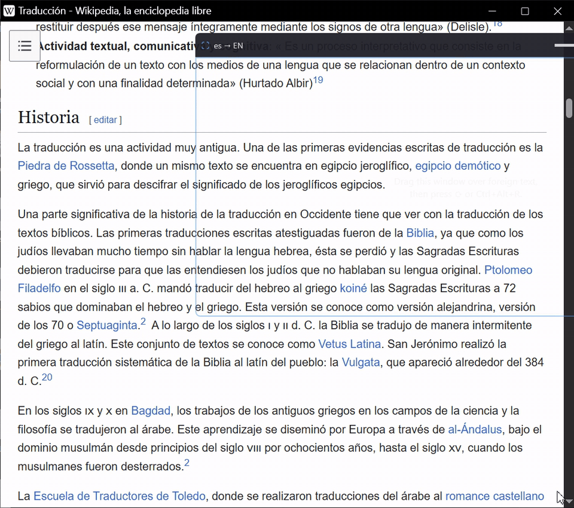
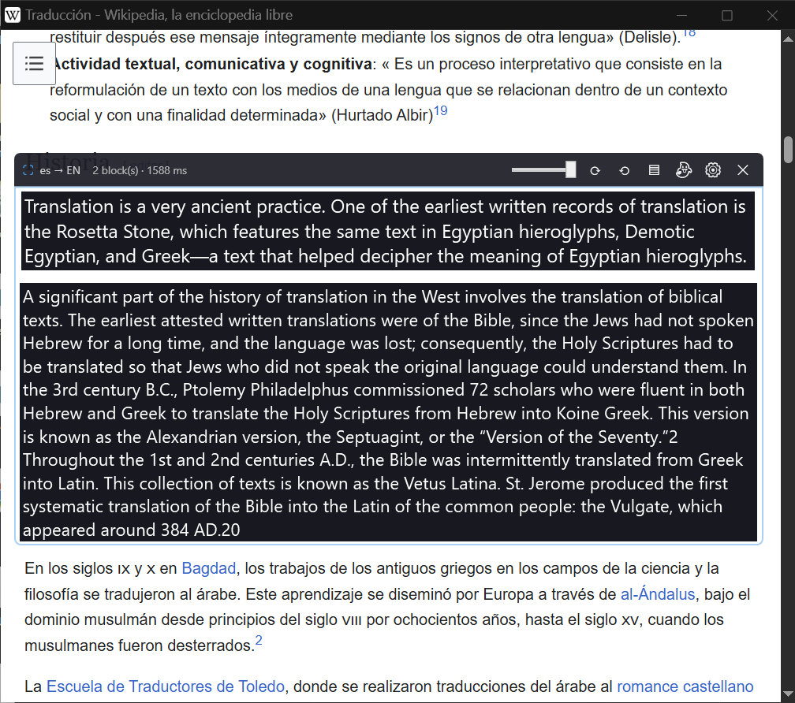
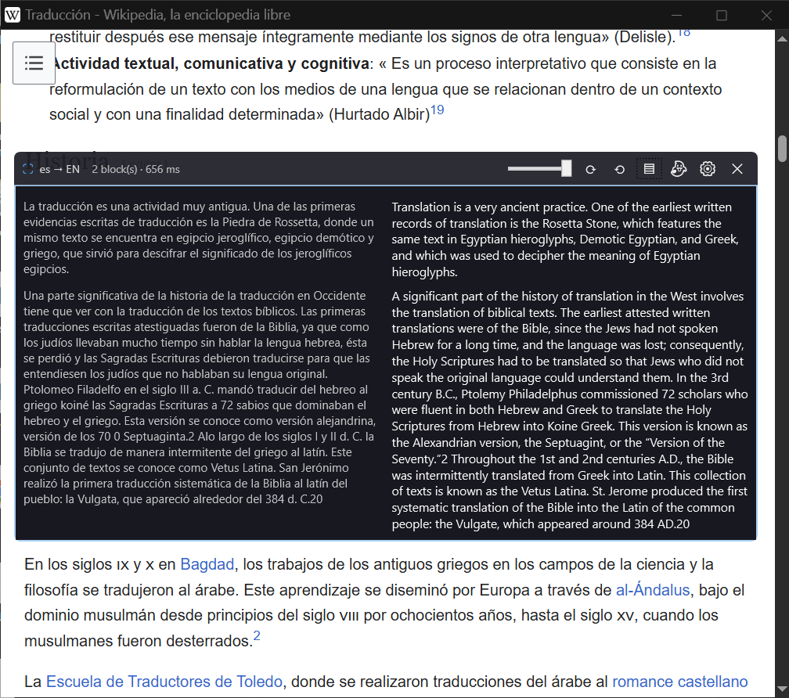
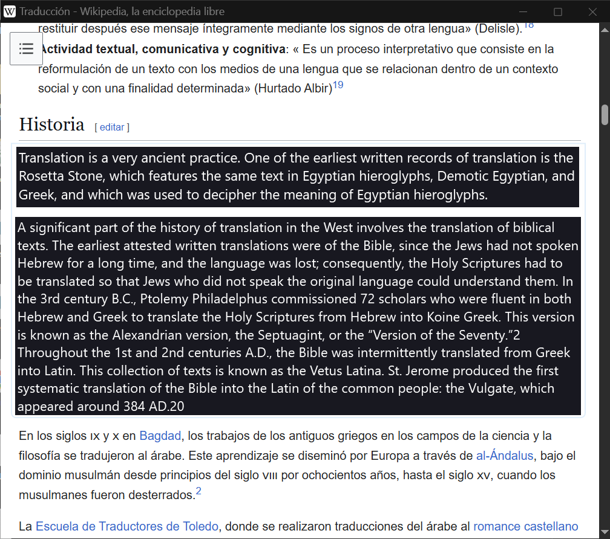
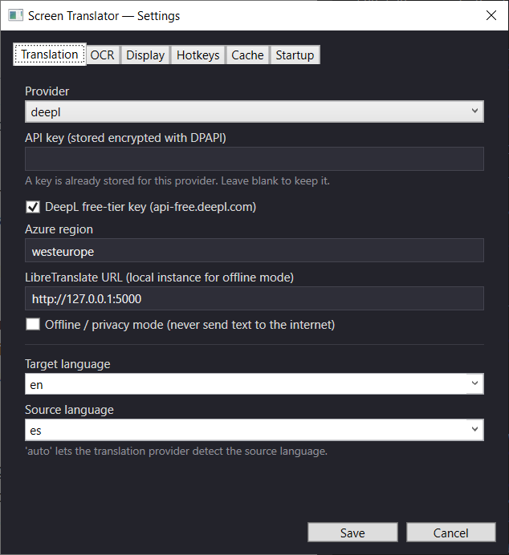
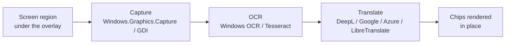

# Screen Translator

**Translate anything on your screen, right where it is.**

Drag a window over foreign text in a game, a PDF, a video or a website, and the translation
appears on top of the original text.

Demo text: <a href="https://es.wikipedia.org/wiki/Traducci%C3%B3n">Wikipedia, "Traducción"</a>, <a href="https://creativecommons.org/licenses/by-sa/4.0/">CC BY-SA 4.0</a>. Recorded from the real app with Windows OCR and DeepL.

  

[All releases](https://github.com/Ian-Louw/screen-translator-releases/releases) · per-user install, no admin needed

---

## What it does

Screen Translator puts a resizable overlay window on your screen. Everything under it is
captured, read with OCR, translated, and drawn back over the original text. It works on any
app you can see: games, PDFs, videos, browsers, chat apps.

## Feature tour

### Translations in place

The translation is drawn over the original text as "chips", with the font sized to fit each
block. The page keeps its layout, so you read it where you found it.

### Side-by-side panel

Prefer to see both? The ▤ button cycles the display mode: in place, a side-by-side panel
(original on the left, translation on the right), or hover tooltips.

### Ghost mode

Ghost mode (👻 or `Ctrl+Alt+G`) hides the toolbar and makes the overlay click-through, so you
can keep scrolling, clicking and playing underneath while the translations stay on screen.

### Auto-refresh

Turn on ⟲ and the translations follow the screen: scroll the page underneath and the chips
update on their own. While the screen is still, it sits idle: near-zero
CPU and no translation calls.

### Hotkeys

Global and configurable in Settings:

| Hotkey | Action |
|---|---|
| `Ctrl+Alt+R` | Translate now (re-capture and re-translate) |
| `Ctrl+Alt+T` | Show / hide the overlay |
| `Ctrl+Alt+G` | Ghost (click-through) mode on / off |
| `Ctrl+Alt+S` | Open Settings |

### Pick your translator and your OCR

- **Translation:** DeepL, Google Cloud Translation, Azure Translator, or LibreTranslate
  running on your own machine.
- **OCR:** Windows OCR (uses the language packs you already have), or Tesseract for languages
  Windows OCR doesn't cover.

## Quick start

1. **Download and install.** Run
   [`ScreenTranslator-win-Setup.exe`](https://github.com/Ian-Louw/screen-translator-releases/releases/latest/download/ScreenTranslator-win-Setup.exe).
   The installer is not code-signed yet, so Windows SmartScreen says "Windows protected your
   PC". Click **More info → Run anyway**. It installs for your user only; no admin prompt.
2. **Choose a translator.** Press `Ctrl+Alt+S` (or the ⚙ button) and open the
   **Translation** tab. Pick a provider and paste its API key, or pick **libretranslate** for a
   local server. Set your target language.
3. **Translate.** Drag the overlay over foreign text and press ⟳ (or `Ctrl+Alt+R`).

| Provider | Where to get a key |
|---|---|
| DeepL | [deepl.com/pro-api](https://www.deepl.com/pro-api) (the free tier is 500,000 characters a month) |
| Google Cloud Translation | Google Cloud console → enable *Cloud Translation API* → API key |
| Azure Translator | Azure portal → *Translator* resource → Keys & Endpoint (also set the region) |
| LibreTranslate | No key: run it locally (`pip install libretranslate && libretranslate`) |

## How it works

If the captured image hasn't changed since the last pass, the pipeline stops after the
capture step: no OCR and no translation calls. All the text in a frame goes to the provider in
one batched request.

## Privacy

- **Screen text goes only to the provider you pick**: DeepL, Google, Azure, or your own
  LibreTranslate server.
- **API keys are encrypted on disk** with Windows DPAPI (your user account only). They are
  never written in plain text, and another user or machine can't decrypt them.
- **LibreTranslate keeps everything local.** Turn on **Offline / privacy mode** in Settings and
  the app never sends text to the internet.
- Translations are cached on disk to save calls. The cache is not encrypted; turn it off in
  Settings → Cache if the text you translate is sensitive.

## Updates

The installed app checks for a new release in the background when it starts and downloads it
quietly. A tray notification says **"Update ready — restart to apply"**; the update installs
when you exit the app (tray → **Exit**). The app never restarts itself. Use the tray menu's
**Check for updates** to check on demand.

The portable zip on the releases page runs from any folder, but it doesn't update itself.

## Uninstall

Windows **Settings → Apps & features → Screen Translator → Uninstall**.

Your settings, logs and translation cache stay in `%APPDATA%\ScreenTranslator`. Delete that
folder for a full clean-up.

## Requirements

Windows 10 (version 1809 or later) or Windows 11. Nothing else to install; the app is
self-contained.
